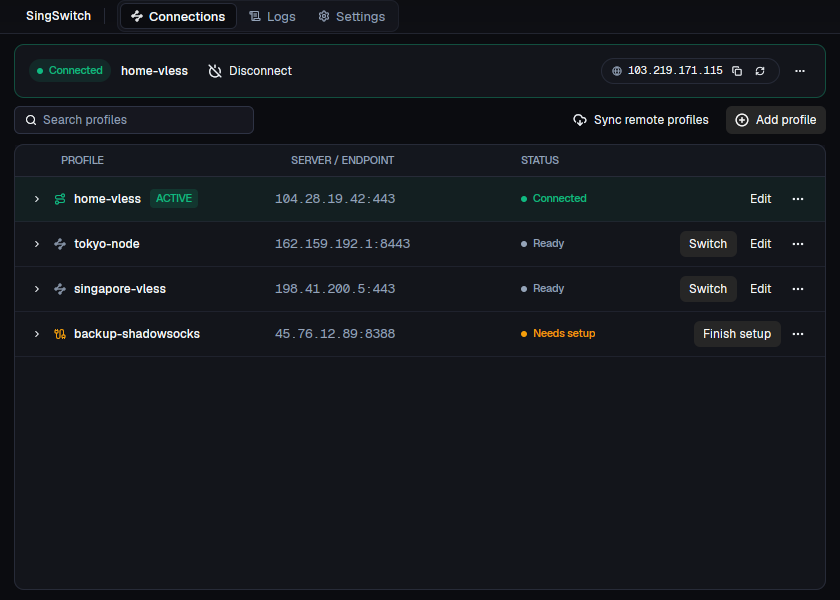
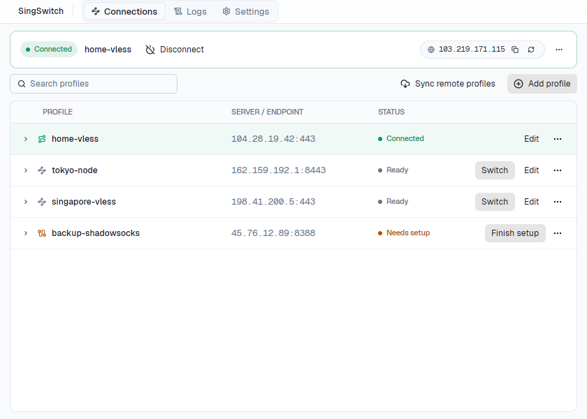
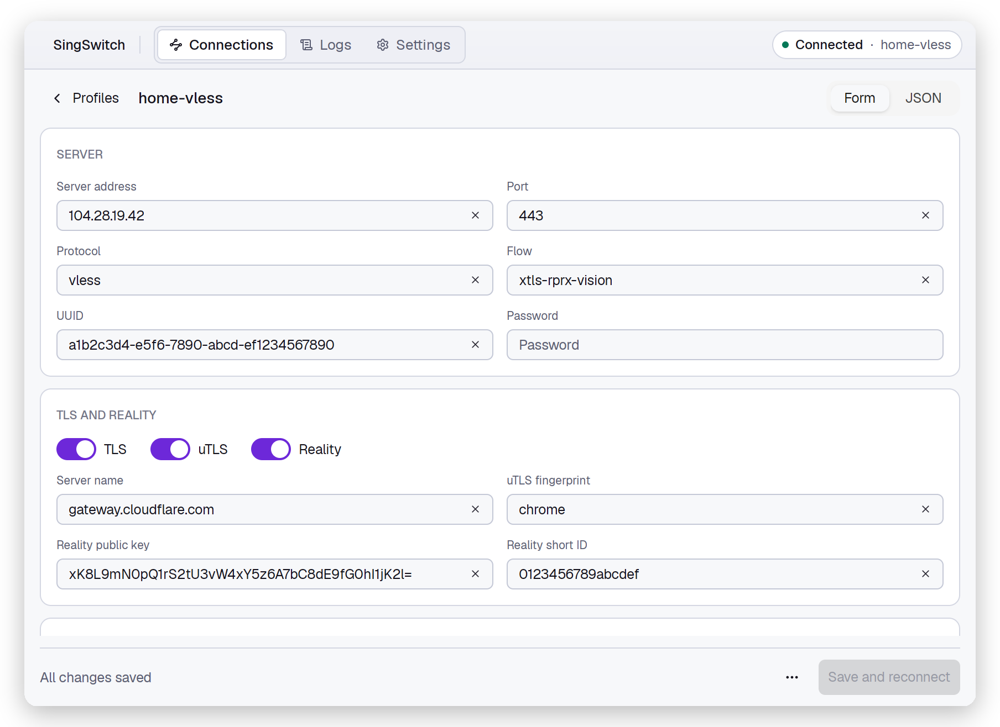
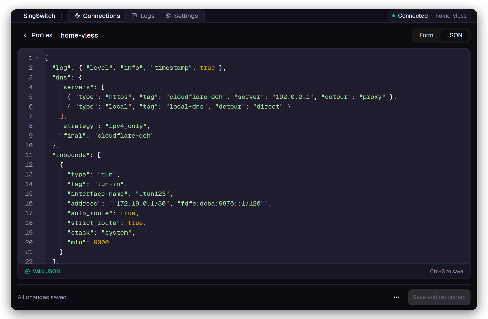
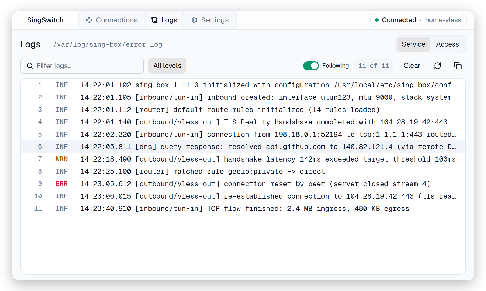
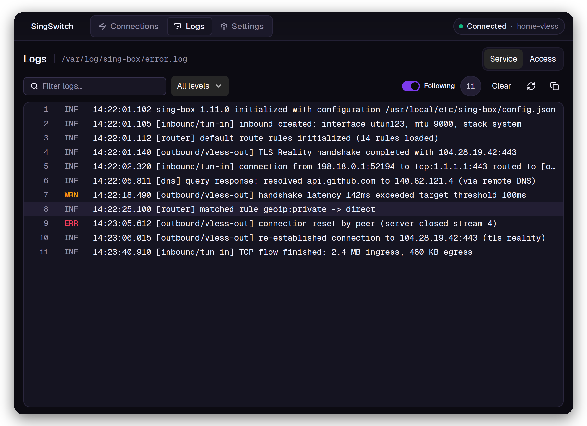
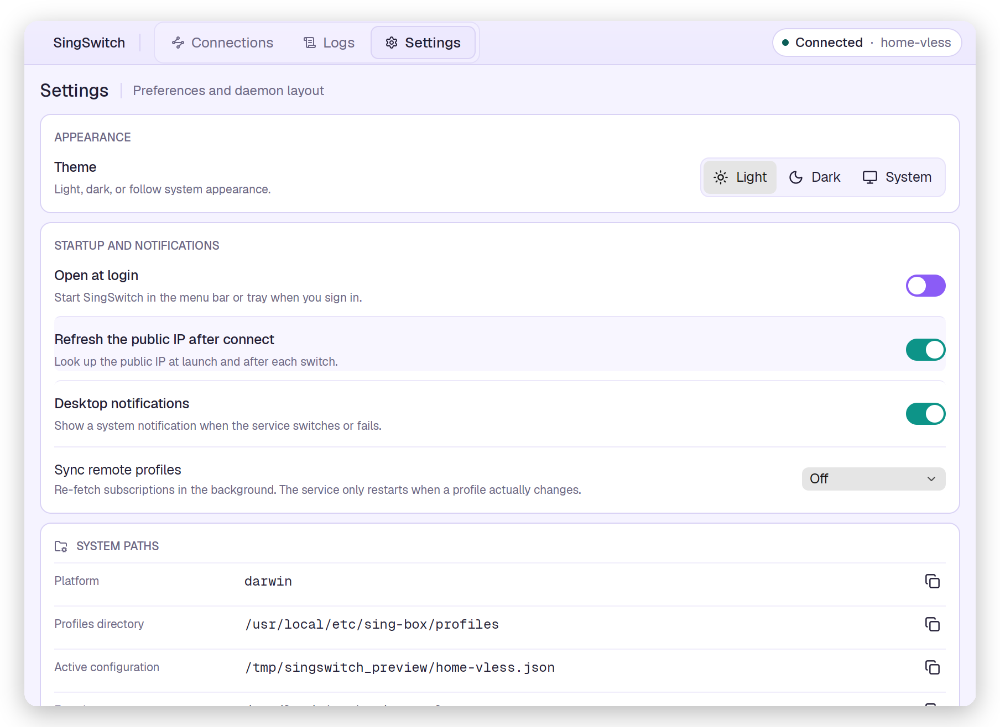

<p align="center">
  
</p>

<h1 align="center">SingSwitch</h1>

<p align="center">A native GUI for switching <a href="https://sing-box.sagernet.org/">sing-box</a> profiles without losing your connection.</p>

<p align="center">
  
  
</p>



When sing-box runs through a TUN interface, switching to a broken profile kills your network along with the daemon. SingSwitch guards the switch: it validates the config first, activates it atomically, and rolls back to your previous profile if the daemon fails within the health window.

That's it. The editor, logs, IP display, and CLI are conveniences layered on that one switch.

## Screenshots

<table>
  <tr>
    <td></td>
    <td></td>
  </tr>
  <tr>
    <td></td>
    <td></td>
  </tr>
  <tr>
    <td></td>
    <td></td>
  </tr>
  <tr>
    <td></td>
    <td></td>
  </tr>
</table>

Also here: a guided form editor alongside the JSON one, log streaming with filtering, a per-profile latency column, a CLI with `--json` for everything, and a native tray. The tray shows current status in its icon, switches profiles directly from the menu, and pins the app to the menu bar (macOS) or system tray (Windows) at login. Light and dark themes included.

## Install

```bash
# macOS
./scripts/build-mac.sh
./scripts/install-macos.sh
```

```powershell
# Windows (Administrator)
cargo build --release --workspace --target x86_64-pc-windows-msvc
./scripts/fetch-sing-box.sh windows-amd64 target/x86_64-pc-windows-msvc/release
.\scripts\install.ps1
```

Uninstall: `./scripts/uninstall-macos.sh` or `.\scripts\uninstall.ps1`.

## CLI

`use`, `off`, `status`, `list`, `add`, `pull`, `sync`, `edit`, `rm`, `check`, `logs`, `ip` cover switching and lifecycle. Share-link import, latency tests, selector-group switching and scheduled auto-sync live in the app only. All commands take `--json`; exit codes are fixed at 0-4 ([docs/cli-json.md](docs/cli-json.md)).

## Security

Profile activation is an unprivileged atomic symlink swap, so there is no root daemon and no persistent privileges. Service restarts go through four `NOPASSWD` sudo rules on macOS and a named pipe on Windows. Details in [SECURITY.md](SECURITY.md).

## License

[MIT](LICENSE)
