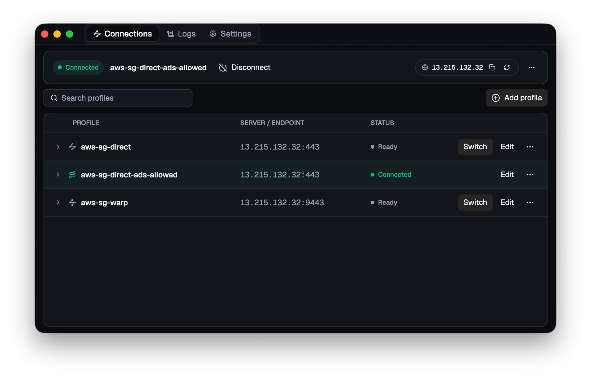
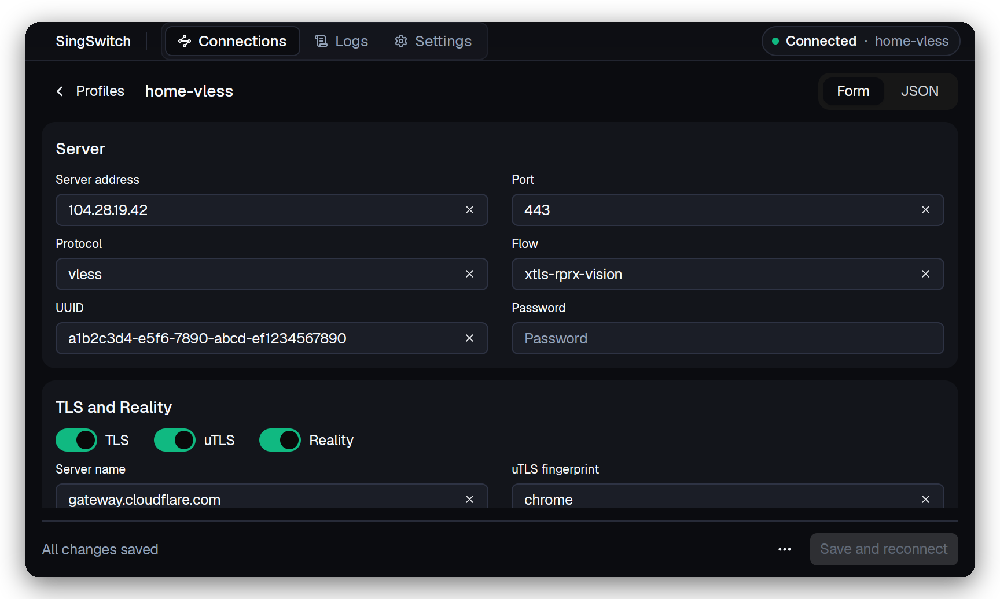
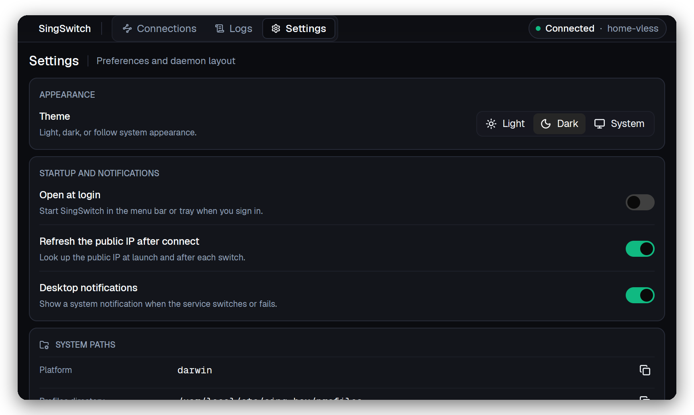

<p align="center">
  
  &nbsp;&nbsp;&nbsp;
  
</p>

<h1 align="center">SingSwitch</h1>

<p align="center">
  <strong>Crash-safe, zero-loss proxy switching for <a href="https://sing-box.sagernet.org/">sing-box</a>.</strong>
</p>

<p align="center">
  <a href="#install">Install</a> •
  <a href="#why-singswitch">Why SingSwitch</a> •
  <a href="#interface">Interface</a> •
  <a href="#cli">CLI</a> •
  <a href="#architecture--security">Security</a> •
  <a href="LICENSE">License</a>
</p>

<p align="center">
  
  
  
  
</p>

<br />

<p align="center">
  
</p>

---

## Why SingSwitch?

When [sing-box](https://sing-box.sagernet.org/) routes your system traffic through a TUN interface, swapping proxies requires swapping configurations and restarting the service daemon. 

If a remote endpoint is dead, TLS handshakes fail, or the configuration contains a subtle syntax error, the daemon exits or panics. **You are left completely disconnected**—without the network connection required to look up solutions or revert the configuration.

SingSwitch eliminates this failure mode:

1. **Pre-flight verification**: Runs `sing-box check` against the target configuration before making any changes.
2. **Atomic activation**: Performs an unprivileged atomic symlink swap so the daemon only ever reads a valid target.
3. **Health window guard**: Restarts the service and actively watches it for 2.5 seconds. If the process exits, changes PID, or crashes, **SingSwitch automatically restores the previous working profile**. You stay online.

---

## Interface

SingSwitch is built in Rust on **GPUI**, delivering native 120 FPS rendering, instant sub-second launch, and a resident memory footprint of under 35 MB.

### Connections & Network Status
Manage active routing endpoints, monitor public egress IP addresses with one-click copy, and switch profiles instantly.

| Dark Theme | Light Theme |
| :---: | :---: |
|  |  |

### Dual-Mode Configuration Editor
Edit profiles via guided visual forms or direct JSON with real-time syntax checking and keyboard shortcuts (`⌘S` / `Ctrl+S`).

| Guided Setup Form | Syntax-Validated JSON Editor |
| :---: | :---: |
|  |  |

### High-Density Live Logs & Settings
Follow live daemon error and access logs with regular expression filtering, level color-coding, and granular settings cards.

| Live Logs Stream | Preferences & Daemon Layout |
| :---: | :---: |
|  |  |

---

## Install

### macOS

SingSwitch runs as a menu bar app on macOS (Sonoma, Sequoia, and later on Apple Silicon and Intel).

```bash
# Clone the repository
git clone https://github.com/dasun-sathsara/singswitch.git
cd singswitch

# Build release bundle and install to /Applications and /usr/local/bin
./scripts/build-mac.sh
./scripts/install-macos.sh
```

### Windows

Runs as a system tray application and background Windows service (WinSW):

```powershell
# In PowerShell (Administrator)
cargo build --release --workspace --target x86_64-pc-windows-msvc
./scripts/fetch-sing-box.sh windows-amd64 target/x86_64-pc-windows-msvc/release
.\scripts\install.ps1
```

### Uninstallation

```bash
# macOS
./scripts/uninstall-macos.sh        # Keeps profiles in /usr/local/etc/sing-box
./scripts/uninstall-macos.sh --purge # Cleans all profiles and service logs

# Windows (PowerShell)
.\scripts\uninstall.ps1
```

---

## CLI

SingSwitch includes a full-featured CLI that shares the core engine with the GUI app. Every window operation has an exact CLI equivalent.

```bash
singswitch                     # Interactive TTY profile switcher
singswitch use <name>          # Switch profile with automatic health rollback
singswitch off                 # Stop sing-box daemon
singswitch status              # Inspect daemon state, active profile, and PID
singswitch list                # List profiles and schema readiness
singswitch add <name>          # Initialize a new profile from template
singswitch pull <name> <url>   # Fetch and validate a remote subscription/profile
singswitch sync [name]         # Re-fetch one or all subscribed profiles
singswitch edit <name>         # Edit configuration in $EDITOR with live validation
singswitch rm <name>           # Delete profile
singswitch check [name]        # Validate active or named profile syntax
singswitch logs [-n 80] [-f]   # Stream and follow sing-box logs
singswitch ip                  # Resolve and display current public egress IP
singswitch completion <shell>  # Generate shell completions (zsh, bash, fish)
```

### Scripting & Automation

All CLI commands support `--json` and emit structured JSON for scripts and orchestration:

```bash
$ singswitch status --json
{
  "running": true,
  "profile": "aws-sg-direct",
  "server": "13.215.132.32:443",
  "interface": "utun123",
  "pid": 71398,
  "public_ip": "103.219.171.115"
}
```

Exit codes follow a fixed schema: `0` (Success), `1` (General error), `2` (Validation failure), `3` (Service crash / rollback triggered), `4` (Missing privileges). See [docs/cli-json.md](docs/cli-json.md).

---

## Architecture & Security

| Path | macOS | Windows |
| :--- | :--- | :--- |
| **Service Daemon** | launchd `app.lexiflix.singswitch-daemon` | WinSW service `sing-box` |
| **Binary Path** | `/usr/local/libexec/singswitch/sing-box` | `%ProgramData%\singswitch\bin\sing-box.exe` |
| **Active Config** | `/usr/local/etc/sing-box/config.json` (symlink) | `%ProgramData%\sing-box\config.json` |
| **Profile Library** | `/usr/local/etc/sing-box/profiles/*.json` | `%ProgramData%\sing-box\profiles\` |
| **Service Logs** | `/var/log/sing-box/{error,access}.log` | `%ProgramData%\sing-box\logs\` |

### Security Model
- **No persistent root privileges**: The GUI app and CLI execute strictly under your unprivileged user account.
- **Scoped elevation**: Service restarts execute via four explicit `NOPASSWD` sudo rules on macOS (or a named pipe on Windows).
- **Unprivileged profile swapping**: Profile activation is an unprivileged atomic symlink rename (`renameat`) in a user-owned configuration directory, closing arbitrary privilege escalation vectors.
- See [SECURITY.md](SECURITY.md) for detailed audit guarantees and security properties.

---

## License

[MIT](LICENSE) © 2026 Dasun Sathsara
